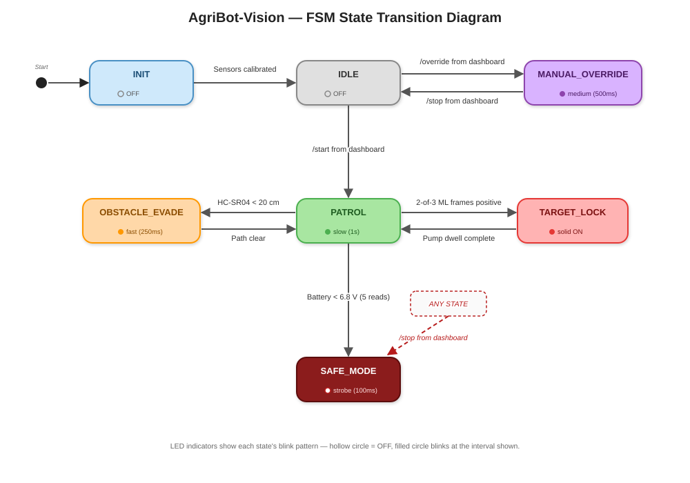

# DeltaShield: Autonomous Precision Weed Eradication Rover
> **Built for Egypt — Engineered for Nile Delta Smallholders**  
> **SolveThe17 2.0 National Hackathon — IEEE EUI Student Branch**  
> **Team:** FieldPilot · **Team ID:** ST17-032 · **Track:** SDG 13: Climate Action (*"Keeping Egypt's Farms Alive"*)

[](https://opensource.org/licenses/MIT)
[](https://www.espressif.com/)
[](https://sdgs.un.org/goals/goal13)
[-brightgreen.svg)]()

---

## 📌 Executive Summary

The Nile Delta contains **over 63% of Egypt’s cultivated land**, yet smallholder farmers (< 2 feddans) face an imminent crisis: under modeled climate change scenarios, wheat and maize yields are projected to fall by **10–12%** and **13–15%** respectively by 2030 due to climate stress and acute irrigation canal water deficits. In this fragile ecosystem, invasive weeds consume up to **30% of scarce applied water**. Smallholders currently resort to manual blanket chemical spraying, poisoning Delta soil microbiomes, wasting money, and endangering family health.

**DeltaShield** is an autonomous, ultra-low-cost agricultural scout and spot-eradication rover developed by **Team FieldPilot (ST17-032)**. Using on-device edge computer vision (TinyML) and dual Time-of-Flight ranging, DeltaShield patrols crop furrows and executes a **calibrated 100-millisecond micro-dose spot spray**, reducing chemical costs and soil toxicity by **up to 90%** while preserving critical irrigation water.

---

## 🚀 Key Innovations & "Built for Egypt" Engineering

1. **"Stop-to-Spray" Drift Elimination:** The rover comes to a complete physical halt before actuating the sprayer, eliminating fluid drift and spray misses caused by field vibrations.
2. **2-of-3 Hysteresis Gate:** A detection event must be confirmed in at least two of three consecutive camera frames before the spray state is triggered, preventing false-positive chemical discharge.
3. **Deterministic Hardware Failsafe (`esp_timer`):** The spray relay is governed by an independent ESP32 hardware timer interrupt that cuts power at exactly 100 ms, guaranteeing that a software hang or Wi-Fi delay can never overdose the soil.
4. **100% Offline Edge Intelligence:** Zero dependency on 4G cellular signal or cloud APIs. The computer vision model runs in the ESP32 internal DRAM, with an offline local Wi-Fi dashboard for farmer telemetry.
5. **Ultra-Low Cost & 100% Local Sourcing:** The complete system is built from components sourced over the counter in Bab El-Louq (Cairo) for **2,490 EGP (~$51 USD)**, paying for itself in under 45 days.

---

## 🛠️ System Architecture


```
                  ┌───────────────────────────────────────────────┐
                  │             DeltaShield Rover                 │
                  └───────────────────────┬───────────────────────┘
                                          │
            ┌─────────────────────────────┼─────────────────────────────┐
            ▼                             ▼                             ▼
   [ Edge Perception ]           [ Motion & Ranging ]         [ Safe Actuation ]
   • AI-Thinker ESP32-CAM        • DRV8833 Dual H-Bridge      • Optocoupled Relay (GPIO4)
   • 96x96 TinyML FOMO Model     • 2x 25GA370 Geared Motors   • 100ms Hardware Timer
   • Internal DRAM Framebuffer   • 2x VL53L1X ToF (Furrows)   • Micro Diaphragm Pump
   • 2-of-3 Voting Filter        • HC-SR04 Ultrasonic (Safety)• 1N4007 Flyback Clamp
```

### Power Subsystem
* **Battery Pack:** 2S 18650 Li-ion cells (2600 mAh, 7.4V nominal / 8.4V max).
* **Protection:** 2S 8A–10A BMS with individual cell balancing and short-circuit protection.
* **Regulation:** LM2596 DC-DC step-down buck converter tuned to precisely 5.00V logic rail.
* **Filtering:** 470 µF electrolytic reservoir + 10 µF high-frequency bypass ceramic capacitor across the 5V logic rail.
* **Grounding:** Single-point common ground bridge (0V reference) uniting all subsystem rails.

---

## 🔌 Hardware Pin Mapping (Revision v4 — Active & Verified)

| Subsystem | Signal Name | ESP32 Pin / Header | Notes & Safety Safeguards |
|---|---|---|---|
| **I2C Bus** | I2C SDA | **GPIO3** | Shared bus: 2x VL53L1X ToF + PCF8574 expander |
| **I2C Bus** | I2C SCL | **GPIO1** | Shared bus: 2x VL53L1X ToF + PCF8574 expander |
| **Drivetrain**| Left Motor AIN1 | **GPIO2** | Direction & PWM line to DRV8833 |
| **Drivetrain**| Left Motor AIN2 | **GPIO13** | Direction & PWM line to DRV8833 |
| **Drivetrain**| Right Motor BIN1| **GPIO12** | Direction & PWM line to DRV8833 |
| **Drivetrain**| Right Motor BIN2| **GPIO15** | Direction & PWM line to DRV8833 |
| **Actuator**  | Spray Relay IN  | **GPIO4** | Native pin (prevents I2C lockup failure). 10 kΩ pulldown |
| **Telemetry** | Battery ADC     | **GPIO14** | 100 kΩ / 47 kΩ divider (sampled at boot before Wi-Fi) |
| **Sensors**   | Ultrasonic ECHO | **GPIO16** | 1 kΩ / 2 kΩ divider (stepped down to 3.3V) |
| **Diagnostic**| Internal Red LED| **GPIO33** | FSM state machine heartbeat indicator |
| **Expander**  | Right ToF XSHUT | **PCF8574 P0** | Dynamic address remapping (0x29 $\rightarrow$ 0x30) |
| **Expander**  | Ultrasonic TRIG | **PCF8574 P1** | 10 µs trigger pulse output |
| **Expander**  | External Status | **PCF8574 P2** | Active-low sink: illuminates when farmer dashboard connects |

---

## 🔄 Finite State Machine (FSM)



1. **`STATE_INIT`:** Brings up I2C bus, dynamically remaps right ToF address, samples battery ADC, spins up local Wi-Fi AP.
2. **`STATE_PATROL`:** Autonomous forward cruise at ~0.15 m/s. Dual ToF sensors calculate cross-track error to center along crop furrows.
3. **`STATE_OBSTACLE_EVADE`:** Ultrasonic sensor catches obstacles (<20 cm). Fail-closed policy treats timeouts as physical obstacles.
4. **`STATE_TARGET_LOCK`:** Weed detection confirmed via 2-of-3 voting filter. Motors halt (0 RPM), 100 ms micro-pulse fires via `esp_timer`, 250 ms dwell period before resuming cruise.
5. **`STATE_SAFE_MODE`:** Automatic latch on low battery (<6.8V) or sensor bus loss. Relay and motors forced LOW.

---

## 💰 Itemized Bill of Materials (Local Egyptian Sourcing)

| Item # | Subsystem | Component Description | Qty | Unit Cost (EGP) | Subtotal (EGP) | Local Egyptian Sourcing Hub |
|:---:|---|---|:---:|:---:|:---:|---|
| **1** | Compute & Vision | AI-Thinker ESP32-CAM (with OV2640 + MB USB Shield) | 1 | 380 | 380 | Ram Electronics / Bab El-Louq |
| **2** | Power | 18650 Li-ion Cells (2600 mAh, 3.7V, Grade-A) | 2 | 120 | 240 | Future Electronics / El-Bustan |
| **3** | Power | 2S 7.4V / 8.4V 8A–10A BMS Protection Module | 1 | 65 | 65 | Ram Electronics / Makers |
| **4** | Power | LM2596 DC-DC Step-Down Buck Converter Module | 1 | 75 | 75 | Future Electronics / Bab El-Louq |
| **5** | Power | DC Barrel Jack (5.5 × 2.1 mm) + 8.4V 2A Charger | 1 | 140 | 140 | Bab El-Louq Electronics |
| **6** | Power | Decoupling Caps (470 µF 25V Electrolytic + 10 µF Ceramic) | 1 set | 15 | 15 | Bab El-Louq (El-Falaki) |
| **7** | Drivetrain | DRV8833 Dual H-Bridge Motor Driver Module | 1 | 85 | 85 | Ram Electronics / Makers |
| **8** | Drivetrain | 25GA370 Geared DC Motors (12V/6V, 100–150 RPM, High-Torque) | 2 | 260 | 520 | Ram Electronics / Future Electronics |
| **9** | Drivetrain | High-Traction Agricultural Ribbed Wheels + 4mm Couplers | 2 | 80 | 160 | Makers Electronics / Local 3D Print |
| **10** | Drivetrain | Front Stainless Steel Free-Rotating Ball Caster | 1 | 45 | 45 | Bab El-Louq Hardware Market |
| **11** | Sensors | VL53L1X Time-of-Flight (ToF) Distance Sensors | 2 | 220 | 440 | Future Electronics / Ram Electronics |
| **12** | Sensors | HC-SR04 Ultrasonic Distance Sensor | 1 | 60 | 60 | Bab El-Louq / All Cairo Shops |
| **13** | IO Expansion | PCF8574 I2C 8-Bit IO Expander (Repurposed LCD Backpack) | 1 | 55 | 55 | Ram Electronics / Bab El-Louq |
| **14** | Actuation | 5V 1-Channel Relay Module (Optocoupler-Isolated) | 1 | 45 | 45 | Ram Electronics / Bab El-Louq |
| **15** | Actuation | 5V–12V Micro Diaphragm Submersible Dosing Pump | 1 | 120 | 120 | Bab El-Louq / Aquarium Supplies |
| **16** | Actuation | Precision Brass Atomizing Misting Nozzle + Silicone Tubing | 1 set | 60 | 60 | Agricultural Hardware / Bab El-Louq |
| **17** | Safety & Passives | Safety Kit (1N4007 Diode, Resistors, Kill Switch, Toggle) | 1 lot | 45 | 45 | Bab El-Louq (El-Falaki) |
| **18** | Structure | Rugged Chassis Baseplate, Standoffs, Screws, and Brackets | 1 set | 180 | 180 | Local Acrylic/Aluminum Cutting |
| **TOTAL** | — | **Complete Functional Autonomous Rover BOM** | — | — | **2,490 EGP** | **100% Sourced Locally in Cairo, Egypt (~$51 USD)** |

---

## 📂 Repository Structure

```
DeltaShield/
├── firmware/
│   ├── DeltaShield_Firmware/       # Production modular Arduino/ESP32 firmware
│   │   ├── DeltaShield_Firmware.ino
│   │   ├── deltashield_logic.h     # 2-of-3 voting filter & steering correction
│   │   ├── pins.h                  # Hardware v4 pin definitions
│   │   ├── motor_control.h         # DRV8833 PWM differential drive
│   │   ├── relay_control.h         # Dedicated esp_timer 100ms hardware interrupt
│   │   ├── sensors.h               # Dual VL53L1X ToF & HC-SR04 drivers
│   │   ├── wifi_server.h           # Offline captive web portal & JSON telemetry
│   │   ├── pcf8574_driver.h        # I2C expander bitwise driver
│   │   └── ml_inference.h          # TinyML Edge Impulse / FOMO model wrapper
│   └── DeltaShield_Diagnostic/     # Standalone benchtop hardware test sketch
│       └── DeltaShield_Diagnostic.ino
├── docs/                           # Detailed technical reports
│   ├── System_Architecture_and_BOM.md
│   └── Field_Deployment_Brief.md
└── images/                         # Architectural diagrams & schematics
```

---

## ⚡ Quick Start: Flashing & Bringing Up DeltaShield

1. **Hardware Preparation:**
   - Unplug I2C bus wires on GPIO1 and GPIO3 before flashing (these share UART pins).
   - Connect the ESP32-CAM via its USB motherboard shield.
2. **Arduino IDE / PlatformIO Configuration:**
   - Board: `AI Thinker ESP32-CAM`
   - CPU Frequency: `240MHz (WiFi/BT)`
   - Flash Mode: `QIO` / `80MHz`
   - Partition Scheme: `Huge APP (3MB No OTA/1MB SPIFFS)`
3. **Flashing:**
   - Open `firmware/DeltaShield_Firmware/DeltaShield_Firmware.ino` and upload.
   - Reconnect GPIO1 and GPIO3 to the I2C bus.
4. **Field Telemetry Access:**
   - Connect your phone/laptop to the rover's local Wi-Fi:  
     **SSID:** `FieldPilot-DeltaShield` | **Password:** `FieldPilot2026!`
   - Open any browser and navigate to `http://192.168.4.1`
   - Control Credentials: Username `admin` | Password `FieldPilot123`

---

## 📄 License & Attribution

This project is open-source under the [MIT License](LICENSE).  
Developed by **Team FieldPilot (ST17-032)** for the **SolveThe17 2.0 National Hackathon** organized by the **IEEE Egypt University of Informatics (EUI) Student Branch**.
